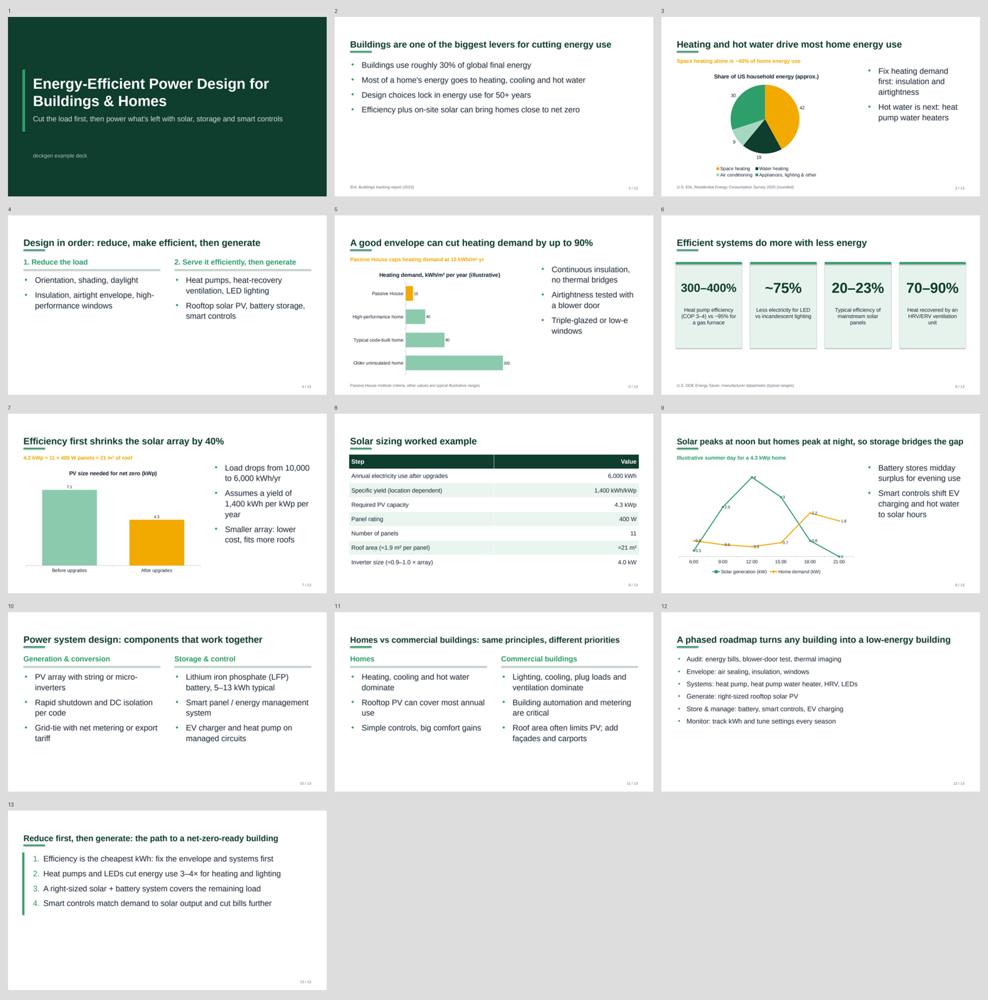

# deckgen: automatic presentation generator

Turn a **topic**, a **Markdown/YAML outline** or a **CSV/JSON data file** into a finished presentation:
an editable **PowerPoint (.pptx)** with native charts, tables and speaker notes, a self-contained **HTML slideshow**,
and a **PDF**, all themed consistently.



*Example: [`examples/energy-efficient-buildings.md`](examples/energy-efficient-buildings.md) →
[PPTX](docs/preview/energy-efficient-buildings.pptx) · [PDF](docs/preview/energy-efficient-buildings.pdf) ·
[HTML](docs/preview/energy-efficient-buildings.html)*

## Features

- **4 input modes**
  - `generate`: Claude writes the whole deck from a topic (structured output, validated against the deck schema)
  - `outline`: a Markdown or YAML outline you write by hand; deterministic, no API key needed
  - `data`: a CSV/JSON file becomes KPI cards, highlighted charts, a data table and takeaways
  - `batch`: many decks from one YAML job file, for cron jobs or CI
- **11 layouts**: title, section, bullets, two-column, chart (column/bar/line/pie with a highlighted key finding and
  call-out), table, metrics (big-number cards), quote, image, references, conclusion.
- **7 themes** plus custom YAML themes: `academic`, `corporate`, `evergreen`, `coastal`, `midnight`, `noir`, `terracotta`.
- **Two writing styles**
  - `business`: action titles, varied layouts, ends on next steps
  - `academic`: embeds the [academic-pptx-skill](https://github.com/Gabberflast/academic-pptx-skill) guidelines,
    with action titles, the ghost-deck test, ≤40 words per slide, citations and a References slide
- **QA built in**
  - `deckgen lint` checks titles, word and bullet limits, chart data, placeholders and the academic checklist
  - `deckgen thumbnails` renders slide PNGs plus a contact sheet for visual review
  - Overlong slides are auto-split and fonts auto-fit
- Every run saves an editable `*.deck.json`: tweak AI output and re-render with `deckgen render`.

## Install

```bash
pip install -e ".[qa]"          # qa extra = thumbnails (pypdfium2 + Pillow)
# PDF export / thumbnails also need LibreOffice with Impress (e.g. apt install libreoffice-impress)
cp .env.example .env            # add ANTHROPIC_API_KEY for AI generation
```

## Usage

```bash
# 1. AI: Claude writes the deck (falls back to an editable skeleton without an API key)
deckgen generate "Heat pump retrofit program for a mid-size city" --slides 12 --audience "city council" \
    --theme evergreen -f pptx,html,pdf,json
deckgen generate "My paper on rooftop solar rebound effects" --style academic --context paper.md

# 2. Outline: full control, no API key
deckgen outline examples/energy-efficient-buildings.md -f pptx,html,pdf

# 3. Data: report deck from a spreadsheet export
deckgen data examples/sales.csv --title "H1 Sales Report" --theme coastal

# 4. Batch: automation
deckgen batch examples/batch.yaml -o out/batch

# Edit, re-theme, check
deckgen render out/my-deck.deck.json --theme midnight
deckgen lint examples/academic-talk.md          # prints the ghost deck and any issues
deckgen thumbnails out/my-deck.pptx             # slide PNGs + contact-sheet.png
deckgen themes
```

Outputs go to `out/` by default (`-o` to change). Default model: `claude-opus-5` (override with `--model` or
`DECKGEN_MODEL`). AI requests use adaptive thinking and server-side refusal fallbacks.

### Outline format (Markdown)

````markdown
---
title: Deck title
subtitle: Optional subtitle
author: Your name
style: business        # or academic
theme: evergreen
---
# Section divider
## Action title stating the takeaway      (add {conclusion} / {section} ... to force a layout)
Subtitle: optional line under the title
- bullet
Source: (Author, 2024)                   ← citation footer
Notes: speaker notes until the next heading

## Two columns appear when a slide has two ### headings
### Left
- point
### Right
- point

## Charts, tables and metrics are fenced blocks
```chart
type: column            # column | bar | line | pie
categories: [A, B, C]
series: [{name: Sales, values: [3, 7, 4]}]
highlight: 1            # key finding gets the highlight color
annotation: B is 2x the average
```
| Pipe | tables |
|---|---|
| work | too |
```metrics
- {value: "42%", label: Share of energy}
```
> A quote
-- Attribution
````

YAML outlines (`examples/outline.yaml`) and `*.deck.json` files use the same schema as `deckgen/models.py`.

### Python API

```python
from deckgen import Deck, Slide, Layout, build
from deckgen.ai import generate_deck

deck = generate_deck("Solar for schools", slides=8, audience="school board")
build(deck, "out", ["pptx", "html", "pdf"], theme="evergreen")
```

### Custom theme

```yaml
# brand.yaml → deckgen outline talk.md --theme brand.yaml
name: brand
font: Arial
background: "FFFFFF"
title_background: "0B2545"
primary: "0B2545"
accent: "13A89E"
highlight: "F4A261"
chart_colors: ["13A89E", "8DA9C4", "0B2545"]
```

## Automation (GitHub Actions)

- **CI** (`.github/workflows/ci.yml`) runs ruff and the tests, then builds every example deck on each push.
- **Generate deck** (`.github/workflows/generate.yml`): go to *Actions → Generate deck → Run workflow* and enter a
  topic. You get a downloadable PPTX/HTML/PDF plus thumbnails. Add the `ANTHROPIC_API_KEY` repository secret for
  AI-written content.

## Project layout

```
src/deckgen/
  models.py            Deck / Slide / ChartSpec schema (shared by everything)
  ai/                  Claude generator, prompts, offline skeleton
  parsers/             Markdown, YAML/JSON outlines, CSV/JSON data
  renderers/           pptx (python-pptx), html (single file + SVG charts), pdf + thumbnails (LibreOffice)
  themes/builtin/      theme YAML files
  qa/                  lint rules
  guidelines/academic/ vendored academic-pptx-skill (MIT)
examples/              outlines, data, batch job file
docs/preview/          rendered example decks
.claude/skills/deckgen Claude Code skill for driving this repo
```

## Credits

- Academic guidelines: [Gabberflast/academic-pptx-skill](https://github.com/Gabberflast/academic-pptx-skill) (MIT),
  vendored in `src/deckgen/guidelines/academic/`.
- Design and QA approach inspired by Anthropic's
  [pptx skill](https://github.com/ComposioHQ/awesome-claude-skills/blob/master/document-skills/pptx/SKILL.md). It is
  proprietary, so no files are copied; deckgen reimplements the ideas: content-informed palettes, web-safe fonts,
  and a thumbnail QA loop.

## Development

```bash
make install && make lint && make test
make preview        # rebuild the energy example + thumbnails
```
